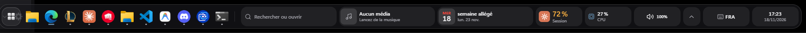
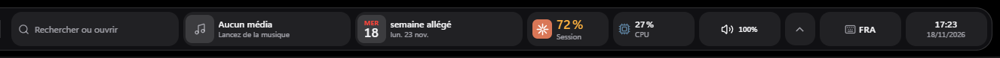

# WinGlass

Dock flottant de widgets qui remplace la barre des tâches de Windows 10/11 (x64).

[Soutenir le projet sur Ko-fi](https://ko-fi.com/ayoubyone)



Applications épinglées et ouvertes, recherche intégrée, musique, agenda, usage IA, système, volume et horloge dans une seule barre.



## Installer

Télécharge `WinGlass_<version>_x64-setup.exe` dans la dernière [release](https://github.com/Ayoub-Yone/WinGlass/releases/latest).
L'application n'est pas signée : à l'avertissement SmartScreen, clique sur **Informations complémentaires**, puis **Exécuter quand même**.

## Bon à savoir

- **Ctrl + Alt + Shift + R** restaure la barre des tâches de Windows à tout moment (aussi : clic droit sur le dock › « Restaurer et quitter »).
- **Masquer automatiquement le dock** (Paramètres › Dock) : la barre se cache quand le curseur s'éloigne et revient au bord bas de n'importe quel écran.
- Mises à jour automatiques : l'application vérifie les nouvelles versions sur GitHub Releases (aucune autre donnée envoyée).
- Aucune télémétrie. Les données restent dans `%APPDATA%\winglass`.

## Développer

Prérequis : Node 20+, Rust stable, WebView2.

```bash
npm install
npm run tauri dev       # lancer en développement
npm run tauri build     # installeurs NSIS + MSI
cd src-tauri && cargo test --lib
```

Stack : Tauri v2 (Rust, `windows` crate), React 19, TypeScript, Tailwind CSS v4, WebGL2.

## Politique de signature du code

Les installateurs sont compilés par GitHub Actions à partir de ce dépôt public (`.github/workflows/release.yml`).
Les mises à jour automatiques sont signées avec une clé dédiée. Seul le mainteneur, Ayoub-Yone, approuve les versions publiées.
WinGlass ne collecte aucune donnée personnelle et ne contient aucun code malveillant.
